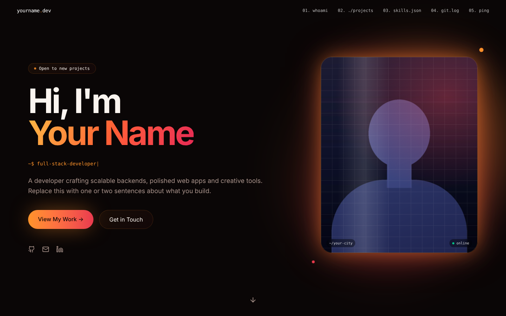

# Ember: a dark, glowing developer portfolio

A free portfolio template: black and ember-orange, a tilting photo with a glowing halo, smooth scrolling, scroll-driven motion and optional live GitHub stats. Fork it, change one file, deploy it for free.

**Live demo:** https://rakibulx33.github.io/portfolio-ember/



## Make it yours in 5 steps

The template ships with the original content of [rakibulx33.me](https://rakibulx33.me)'s first design, so you can see it working. Swap in your own:

1. Click **Use this template** (top right) to copy it to your own account.
2. Edit [`src/config.ts`](src/config.ts): your name, intro, about text, email, social links and skills.
3. Replace [`public/profile.jpg`](public/profile.jpg) with your photo (portrait, about 4:5, under 300 KB).
4. Set `GITHUB_USER` in `src/config.ts` to your username to show your real repos, stars and contribution heatmap. Leave it empty to show the three sample projects instead.
5. In your repo go to **Settings → Pages → Source: GitHub Actions**. Every push to `main` then deploys your site.

Finally, update the title and description in `index.html`, and add your own canonical URL and Open Graph image there (they are left out on purpose, so a copy never points search engines at someone else's site).

## Run it locally

```bash
npm install
npm run dev      # http://localhost:5173
npm run build    # → dist/
```

## What's inside

- Vite, React 19 and TypeScript
- Tailwind CSS v4 with `ember` design tokens in `src/styles.css`
- Framer Motion for scroll and reveal animations, Lenis for smooth scrolling, lucide-react icons
- The live GitHub section calls the public GitHub API from the browser, so there is no server and no token

## Change the colours

Open `src/styles.css` and edit the `--ember`, `--rose` and `--background` values at the top. The gradients and glows all follow them.

## More themes

- **Circuit**: green and gold, with a circuit-board hero (`portfolio-circuit`)
- **Terminal**: an interactive terminal portfolio (`portfolio-terminal`)

## Credit

Designed by [Rakibul Hasan](https://github.com/rakibulx33). MIT licensed: use it for anything, and a link back is appreciated, never required.
